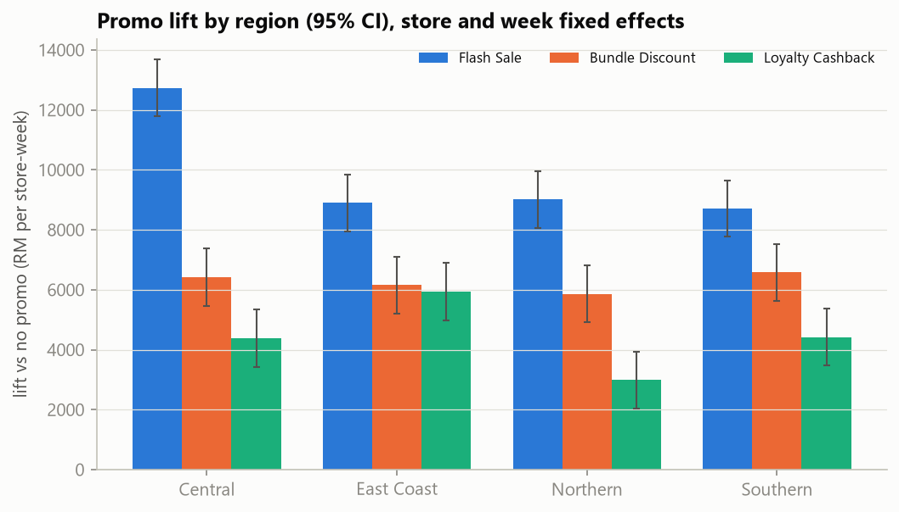
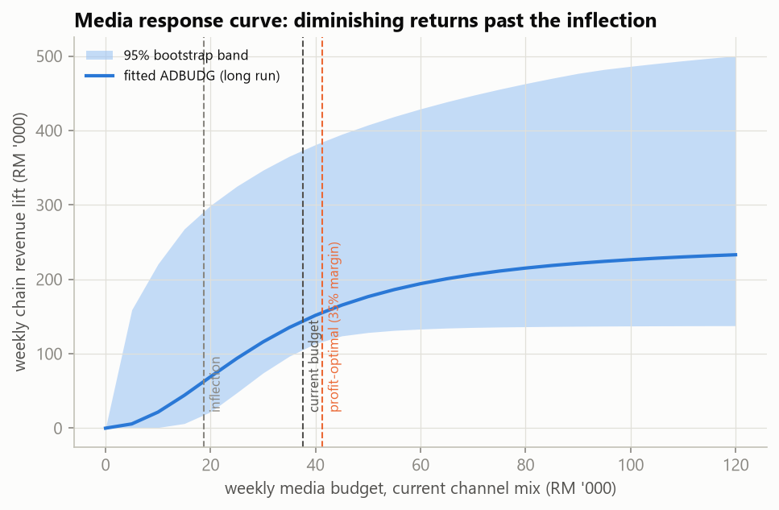
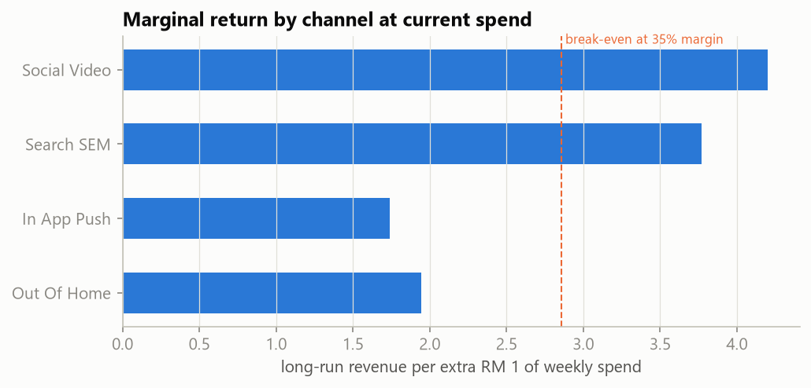
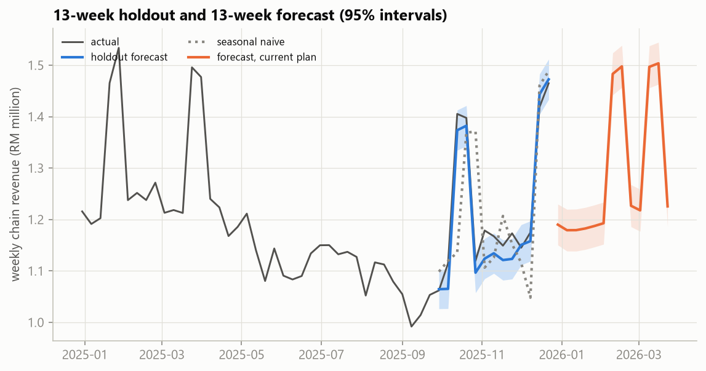

# Multi-Channel Retail Demand Forecasting & Marketing ROI Optimizer

A **simulation study** of a 12-store Malaysian retail chain over 156 weeks (Jan 2023 – Dec 2025). The
study asks three questions with a PostgreSQL database and three statistical modules:

1. **Which promotion works, and does it depend on the region?** A randomised promo experiment, analysed
   as a split-plot ANOVA with Tukey-Kramer comparisons.
2. **How much revenue does media spend buy, and what weekly budget maximises profit?** A chain-level
   regression with Newey-West errors, then a nonlinear ADBUDG response curve with adstock and channel weights.
3. **What will the next 13 weeks look like?** A regression with ARMA errors (statsmodels SARIMAX), tested
   on a 13-week holdout.

> **The store sales, promotions and media spend are simulated.** Real store-level media spend is not
> public, so the data comes from a generator with known true parameters and random noise. Only the
> Malaysian festive calendar and the OpenDOSM consumer price index are real. Because the truth is known,
> the project can check whether each method recovers it, which it does below. A real chain's data would
> not allow that check.

## Data provenance

| Item | Source | Notes |
| :--- | :--- | :--- |
| Festive calendar | **Real**: Malaysian public holidays | CNY, Hari Raya Aidilfitri, Deepavali, Christmas; the flag covers the festival week and the week before |
| CPI | **Real**: [OpenDOSM](https://open.dosm.gov.my/) headline CPI (2010 = 100), monthly | Each week takes its month's CPI; nothing is interpolated |
| Stores (12), regions (4), formats, floor area | Simulated | Same store list as the original brief |
| Promo assignment | Simulated **randomised complete block design** | Every store runs each of the 4 promo types once in every 4-week block |
| Weekly revenue and units | Simulated, with random store effects, an AR(1) chain-wide shock and store-week noise | `src/mcr/simulate.py` |
| Media spend, 4 channels | Simulated: planned budgets, festive uplift, independent lognormal noise, 8 dark weeks | The noise is what makes the channel effects identifiable |

**Keeping the truth away from the analysis.** Only `src/mcr/simulate.py` knows the true parameters.
The estimators (`src/mcr/analysis.py`, scripts 03–05) read the database views and nothing else.
`tests/test_no_leak.py` fails if any of them imports the simulator or mentions `true_params`.
`scripts/06_recovery.py` compares estimates with the truth only after all modules have run.

## Architecture

```
01_simulate ──▶ data/sim/*.parquet ──▶ 02_load_db ──▶ PostgreSQL 16 (Docker, port 5434)
                  └─ true_params.json                   │  regions, stores, weeks, channels, promo_types,
                     (read only by 06)                  │  marketing_spend, promo_assignments, weekly_sales,
                                                        │  model_runs, forecasts
                                                        │  views: vw_store_week, vw_chain_week, vw_rcbd_balance
                                                        ▼
        03_experiment (store-weeks) · 04_response (chain-weeks) · 05_forecast (chain-weeks) ──▶ docs/results/*.json
                                                        │                                    forecasts table
                                                        ▼
                                06_recovery: estimates vs truth (+ Monte Carlo) ──▶ app.py (Streamlit)
```

The schema is in third normal form, with foreign keys, CHECK constraints (Mondays only, non-negative
spend, forecast interval ordering) and a design-balance view. `tests/test_database.py` rebuilds the
chain-level view in pandas from the raw files and checks that it matches the SQL view row by row.

## Module 1: promo experiment (split-plot ANOVA)

Region varies between stores, while promo type varies within a store from week to week. That makes this a
**split-plot** design, and the two factors need different error terms:

- **Region** is tested on store means, against store-to-store variation within a region, with floor area as
  a covariate (ANCOVA, 3 and 7 df).
- **Promo** and **region × promo** are tested against the residual, after store and week fixed effects.
  The week effects absorb everything chain-wide: media, season, festivals and common shocks.

| Source | df | F | p | Partial η² |
| :--- | ---: | ---: | ---: | ---: |
| Region (whole plot, vs Store(Region)) | 3, 7 | 3.56 | 0.075 | 0.60 |
| Promo (vs residual) | 3, 1693 | 583.1 | < 1e-250 | 0.51 |
| Region × Promo (vs residual) | 9, 1693 | 11.1 | 5e-17 | 0.06 |

The marginal promo effects average the four region cells of the interaction model with equal weights, so
every comparison uses the full subplot error. Tukey-Kramer on these correlated contrasts is the usual
approximation, and it is conservative.

| Tukey-Kramer comparison (family 95%) | Lift (RM / store-week) | 95% CI |
| :--- | ---: | :--- |
| Flash Sale vs No Promo | 9,840 | 9,223 – 10,456 |
| Bundle Discount vs No Promo | 6,253 | 5,628 – 6,878 |
| Loyalty Cashback vs No Promo | 4,432 | 3,808 – 5,056 |
| Flash Sale vs Bundle Discount | 3,587 | 2,967 – 4,207 |
| Bundle Discount vs Loyalty Cashback | 1,821 | 1,200 – 2,442 |

**Reading the results:**

- **Interaction:** it is significant, so the region-by-region lifts (the simple effects) matter more than the
  averages. Flash Sale is worth about RM 12.7k per store-week in Central, against roughly RM 9k elsewhere.
  Loyalty Cashback does unusually well on the East Coast.
- **Region:** the region effect is **not** significant at 5%. With only 12 stores (8 store-level degrees of
  freedom), the experiment has little power for a between-store factor. A real chain would need more
  stores per region before claiming regional differences.
- **Residuals:** they show no within-store autocorrelation (mean lag-1 0.01) and equal variance across promos
  (Levene p 0.31).



## Module 2: media response and ROI

Media is bought for the whole chain, so this module models **chain-week totals (n = 156)**. Modelling the
1,872 store-weeks would copy each week's spend 12 times and overstate the evidence.

**Linear distributed-lag regression (Newey-West errors, 4 lags):**

- **Fit:** adjusted R² 0.967.
- **Spend effects:** RM 2,411 of revenue per RM 1,000 spent this week (HAC se 211), plus RM 954 per RM 1,000
  spent last week (se 151).
- **Diagnostics:**
  - Breusch-Godfrey rejects serially uncorrelated errors (p 0.003), which is why the standard errors are HAC.
  - Breusch-Pagan (p 0.58), Jarque-Bera (p 0.10) and Shapiro-Wilk (p 0.31) raise no other concerns.
  - Every VIF is ≤ 1.83.
  - RESET, computed as a HAC Wald test because the errors are autocorrelated, rejects linearity in the fitted
    values (p 0.046).

**ADBUDG response with adstock.** Revenue depends on `ceiling × A^c / (half^c + A^c)`, where `A` is the
adstocked, channel-weighted spend: `A_t = Σ_k w_k·spend_k,t + λ·A_t-1`, with Social Video as the
numeraire (w = 1). The model is fitted by nonlinear least squares, jointly with all the controls.

How it's fitted and compared:

- **Fitting:** the linear coefficients are profiled out (variable projection), and the search uses 12 starting
  points.
- **Confidence intervals:** they come from a moving-block residual bootstrap (300 resamples, 8-week blocks),
  which keeps the autocorrelation.
- **Model choice:** on the same weeks, AIC prefers ADBUDG to the linear model (3131.6 vs 3143.9). That agrees
  with the RESET result above.

| Parameter | Estimate | 95% bootstrap CI | True value |
| :--- | ---: | :--- | ---: |
| Adstock carry-over λ | 0.42 | 0.33 – 0.53 | 0.45 |
| Search SEM weight (vs Social) | 0.90 | 0.44 – 1.46 | 1.30 |
| In-App Push weight | 0.41 | 0.05 – 1.34 | 0.60 |
| Out-of-Home weight | 0.46 | 0.05 – 0.99 | 0.50 |
| Shape c | 2.0 | 0.5 – 4.9 | 1.8 |
| Half-saturation (adstocked RM '000) | 43.5 | 28 – 300 (bound) | 45 |
| Ceiling (RM / week) | 249k | 138k – 1.13M | 240k |
| Festive week effect (chain) | 250k | 235k – 265k | 264k |
| CPI effect (RM per index point) | −15.2k | −17.7k – −12.7k | −14.4k |

**What the curve supports, and what it doesn't:**

- **Weakly identified:** the ceiling, shape and half-saturation point. Past spend rarely went above RM 50k a
  week, so the data cannot say where the curve flattens.
- **Robust:** the decision quantities.

| Budget question (current channel mix, 35% gross margin, **assumed**) | Estimate | 95% CI | True value |
| :--- | ---: | :--- | ---: |
| Current average weekly budget | RM 37.5k | | |
| Inflection (returns start to diminish) | RM 18.7k | 0 – 27.6k | 13.4k |
| Profit-optimal weekly budget | RM 41.3k | 12.7k – 73.6k | 35.5k |

**Recommendations:**

- **Budget:** the current budget sits inside a wide optimal range, so the gain from changing it is small (see the
  forecast scenarios below).
- **How the optimum is defined:** the profit-optimal budget is where one more RM of spend returns RM 1 of gross
  profit in the long run. It must also beat spending nothing. Bootstrap draws in which media never pays count as
  an optimum of 0 rather than being dropped.
- **Channel mix:** at current spend, In-App Push and Out-of-Home return about RM 1.7–1.9 per RM 1, below the
  break-even of RM 2.86 at a 35% margin. Social Video and Search return about RM 3.8–4.2. Moving budget from
  the first pair to the second is the clearer lever, although the channel weights have wide intervals.




## Module 3: forecasting (regression with ARMA errors)

**Stationarity on the training window:**

- **Levels:** borderline. ADF p is 0.075 and KPSS p is 0.072.
- **First differences:** clearly stationary (ADF p < 0.001).

Most of the level movement is explained by known regressors (festivals, season, media), so the model works in
levels, with those regressors and ARMA errors.

**The model:**

- **Regressors:** chain revenue on festive, CPI and promo counts, Fourier annual terms (K = 3, chosen by AIC),
  and the ADBUDG media regressor. The media parameters are re-estimated on the training weeks only.
- **Errors:** ARMA(0,2), chosen by AIC over p, q ≤ 2.
- **Label:** this is a dynamic harmonic regression, fitted with statsmodels `SARIMAX`. It has no seasonal lag-52
  term: Fourier terms carry the annual cycle, which works better with weekly data than a 52-period seasonal
  ARIMA.

**What the model is allowed to know:**

- **Known in advance:** the festive calendar, the promo calendar and the media plan.
- **Not known:** CPI. DOSM publishes it about four weeks after each month ends, so CPI enters with an 8-week lag,
  and the forecast carries the last published value forward.

| 13-week holdout (Sep 29 – Dec 22, 2025) | RMSE (RM) | MAPE |
| :--- | ---: | ---: |
| Regression + ARMA(0,2) errors | 31,114 | 2.19% |
| Same regression without ARMA errors | 30,655 | 2.15% |
| Seasonal naive (same week last year) | 113,736 | 6.31% |

**Reading the holdout:**

- **Main driver:** the regressors do most of the work. Seasonal naive fails mainly because festival dates move
  between years.
- **ARMA errors:** they add nothing at a 13-week horizon. Their dependence fades within two weeks.
- **Interval coverage:** the 95% intervals covered **10 of 13** holdout weeks. They are too narrow, because they
  treat every estimated parameter, including the media curve, as known. Read them as optimistic.

**13-week forecast (Dec 29, 2025 – Mar 23, 2026, including CNY and Hari Raya):**

- **Current media plan:** RM 16.76M, 95% interval RM 16.60M – 16.92M. The interval for the 13-week total comes
  from 2,000 simulated paths, not from summing the weekly bounds. Like the weekly intervals, it ignores
  parameter uncertainty.
- **Raising normal weeks to the profit-optimal budget:** under the same shocks, this adds RM 158k of revenue for
  RM 61k of extra media. At a 35% margin that is **−RM 5k of gross profit**, essentially zero.
- **Why the optimum doesn't pay here:** the Module 2 optimum is a long-run, steady-state budget, while a 13-week
  plan loses the carry-over that decays after week 13 and pays for adstock to build up first. Near the optimum
  the profit curve is also flat. For a short campaign, the steady-state optimum overstates what pays.



## Parameter recovery

All 26 reported estimates have 95% intervals that contain the true value on this dataset. The full table is in
`docs/results/recovery.json`. One dataset can be lucky, so `06_recovery.py --reps 100` re-simulates the chain
100 times with new seeds, re-runs the estimators and measures bias and interval coverage:

| Parameter | True | Median estimate | Mean bias | 95% CI coverage |
| :--- | ---: | ---: | ---: | ---: |
| Flash Sale lift | 9,750 | 9,729 | -0.3% | 0.98 |
| Bundle Discount lift | 6,000 | 5,976 | -0.5% | 0.95 |
| Loyalty Cashback lift | 4,000 | 3,968 | -0.7% | 0.97 |
| Adstock λ | 0.45 | 0.466 | +1.1% | 0.95 |
| Shape c | 1.8 | 1.76 | +7.8% | 0.95 |
| Half-saturation | 45 | 51.6 | +91.3% | 0.91 |
| Search SEM weight | 1.3 | 1.35 | +12.1% | 0.88 |
| In-App Push weight | 0.6 | 0.493 | +17.4% | 0.97 |
| Out-of-Home weight | 0.5 | 0.526 | +28.2% | 0.92 |
| Ceiling | 240,000 | 265,844 | +100.8% | 0.98 |
| Festive effect | 264,000 | 263,584 | -0.5% | 0.92 |
| CPI effect | -14,400 | -13,974 | -0.8% | 0.84 |
| Profit-optimal budget | 35.5 | 35.2 | -6.7% | 0.94 |

The study used 100 simulated datasets with 99 bootstrap resamples each. With 100 datasets,
a coverage figure has a standard error of about 0.02, so values from 0.91 to 0.99 are consistent with 95%.

**Reading the results:**

- **Promo experiment:** essentially unbiased, with close to nominal coverage. The simple effects cover
  0.95 of the time, and the six Tukey-Kramer intervals cover their true values
  together 0.96 of the time.
- **Decision quantities:** the profit-optimal budget (median 35.2k vs true 35.5k), adstock and the festive effect
  are recovered well.
- **Weakly identified:** the mean estimates of half-saturation and the ceiling are badly skewed (+91% and +101%).
  Some datasets push them toward their upper bounds, which is the weak identification described in Module 2.
  Their medians stay close to the truth and their intervals still cover, so the bootstrap is honest about the
  problem.
- **Intervals somewhat too narrow:** the CPI effect (0.84) and the Search SEM weight (0.88) are covered less
  often than the 95% target. Treat those intervals as slightly optimistic.

## Run it

```powershell
docker compose up -d --wait
py -3.13 -m venv .venv
.\.venv\Scripts\python -m pip install -r requirements.txt
.\run_all.ps1                                   # simulate -> load -> 3 modules -> recovery -> tests (~3 min)
.\.venv\Scripts\python scripts\06_recovery.py --reps 100   # optional Monte Carlo (~15 min)
.\.venv\Scripts\streamlit run app.py            # ROI simulator
```

**DBeaver:** connect to PostgreSQL at `localhost:5434`, database `retail_roi`, user `postgres`, password
`roi` (a local demo password), then open `sql/03_dbeaver_workbook.sql`.

**Tests (20):**

- **Unit tests:** adstock, the ADBUDG inflection point, the festive calendar, refusal to invent missing CPI,
  simulation reproducibility and block balance, the profit-optimum condition, and exact recovery of all media
  parameters from noise-free data.
- **No-leak tests** on every analysis file.
- **Database invariants:** row counts, block balance, the SQL chain view matching an independent pandas build,
  CPI matching OpenDOSM, and a complete forecast run.

## Course mapping (UiTM CDCS241)

| Course | Where |
| :--- | :--- |
| ITS472 Database Management Systems | 3NF schema, constraints, window-function views, design-balance view, forecast write-back |
| STA470 Statistical Methods / experimental design | Randomised complete blocks, split-plot ANOVA, Tukey-Kramer, simple effects |
| STA600 Regression analysis | Distributed-lag OLS, Newey-West errors, VIF, Breusch-Pagan, Breusch-Godfrey, RESET |
| STA589 Marketing models | ADBUDG response with adstock and channel weights, profit-optimal budget, marginal ROI |
| STA570 Time series | ADF and KPSS, regression with ARMA errors, Fourier seasonality, holdout against baselines |

## Limitations

- **Simulated data.** The methods are validated against a known truth. That says nothing about how a real
  chain's customers respond.
- **Weak curve identification.** The response curve's ceiling and shape are poorly pinned down, and budgets
  far above past spend are extrapolation. A real chain should run spend tests at higher budgets before acting
  on the upper part of the curve.
- **Assumed margin.** The 35% margin is an assumption. The app lets you change it.
- **Additive promo counts at chain level.** The chain model ignores the region × promo interaction. The
  noise-free test shows this is the only misspecification, and it is small.
